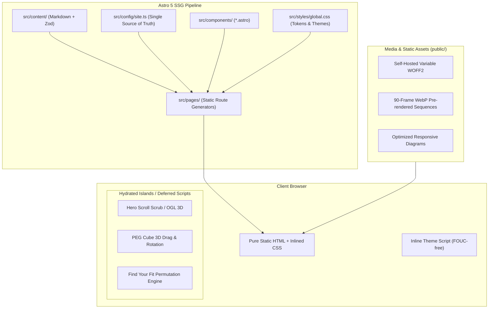

# RHSP (Round Hole Square Peg) - Architecture & Tech Stack Documentation

> **"Wrong shape. Right fit."**  
> Enterprise software shaped around your business: Low-code velocity on OutSystems, bespoke high-code depth in MERN, and sovereign enterprise AI.

---

## 1. Executive Architecture Overview

The RHSP digital platform is a modern, high-performance static enterprise website designed with a **content-first, zero-runtime-overhead philosophy**. It achieves Lighthouse scores of **97–100** across Performance, Accessibility, Best Practices, and SEO through an **Island Architecture** powered by Astro, combining rich WebGL/CSS 3D visuals with lightweight static delivery.



---

## 2. Complete Technology Stack

| Layer | Technology | Version | Purpose / Rationale |
| :--- | :--- | :--- | :--- |
| **Framework** | [Astro](https://astro.build/) | `^5.4.0` | Zero-JS-by-default static site generator (SSG). Only hydrates interactive islands when required. |
| **Language** | [TypeScript](https://www.typescriptlang.org/) | `^5.7.3` | Strict compile-time type safety across site config, component props, and content collections. |
| **3D Graphics** | [OGL](https://github.com/oframe/ogl) | `^1.0.11` | Ultra-lightweight WebGL library (~17 KB gzipped vs ~160 KB for Three.js). Powers dynamic 3D cube rendering. |
| **Type Checking** | [@astrojs/check](https://www.npmjs.com/package/@astrojs/check) | `^0.9.4` | Automated diagnostic checker for `.astro` components and TypeScript interfaces. |
| **SEO & Sitemap** | [@astrojs/sitemap](https://docs.astro.build/en/guides/integrations-guide/sitemap/) | `^3.2.1` | Generates search-engine compliant `sitemap-index.xml` and `sitemap-0.xml` on production build. |
| **Typography** | [@fontsource-variable/figtree](https://fontsource.org/) | `^5.3.0` | High-efficiency variable font (`Figtree 300–900`) self-hosted in WOFF2 format to eliminate external Google Fonts latency. |
| **Image Processing** | [Sharp](https://sharp.pixelplumbing.com/) | `^0.35.5` | High-throughput native image processor for WebP generation, multi-density srcset creation, and OG image rendering. |
| **Styling** | Native Modern CSS | CSS3 / Spec | CSS Custom Properties, CSS Container Queries, CSS 3D Transforms (`preserve-3d`), View Transitions API (`navigation: auto`). |
| **Deployment Target** | Cloudflare Pages / Vercel / Static Host | Node 20+ | Pure static directory `./dist` with zero server runtime dependencies. |

---

## 3. Directory Structure: "What Is Placed Where"

```
RHSP_WEBSITE/
├── .astro/                     # Astro cache & auto-generated types
├── dist/                      # Static production output (built HTML, CSS, JS chunks)
├── public/                    # Unprocessed static assets served directly at root
│   ├── brand/                 # Brand assets (PNG logos, vector icon)
│   ├── fonts/                 # Self-hosted variable fonts (.woff2)
│   ├── media/                 # Processed imagery, architecture diagrams, and frame sequences
│   │   ├── about/             # Apollo 13 blueprint & enterprise diagrams
│   │   ├── hero-seq/          # 90-frame scrub sequences (dark/light, mobile/desktop)
│   │   ├── peg/               # Architecture diagrams for Plan, Engineer, Gen-AI
│   │   ├── products/          # Dedicated product media folders (voice-agents, sovereign-ai, clm, dms, etc.)
│   │   └── raw/               # Master raw videos and images for media pipeline
│   ├── favicon.svg            # Modern SVG favicon
│   ├── og-image.png           # 1200x630 OpenGraph social share card
│   └── robots.txt             # Search crawler directives
├── scripts/                   # Node.js automation and maintenance tools
│   ├── audit-all.js           # Automated mobile Lighthouse CLI auditor
│   ├── generate-og.js         # Headless Sharp script generating branded OG cards
│   └── process-media.js       # FFmpeg & Sharp script converting raw videos into 90 WebP frames
├── src/                       # Core application source code
│   ├── components/            # Reusable Astro UI components
│   │   ├── brand/             # Logo marks and brand SVG primitives
│   │   ├── AgileApproachFlow.astro   # Interactive 4-step delivery stepper (Discover, Shape, Build, Run)
│   │   ├── BeforeAfterSlider.astro   # Interactive before/after transformation slider
│   │   ├── BuildYourWay.astro        # OutSystems vs MERN split comparison card
│   │   ├── ContactSection.astro      # Universal contact card with email trigger
│   │   ├── CurvedArc.astro           # Brand decorative SVG curved sweep accents
│   │   ├── FeaturedCarousel.astro    # Drag & swipeable ideas & insights stories carousel
│   │   ├── Footer.astro              # Global site footer with pillar links and metadata
│   │   ├── Hero.astro                # Hero section with 3D canvas and scroll tracking
│   │   ├── HeroSvgFallback.astro     # Zero-JS pure vector fallback for reduced-motion/low-spec devices
│   │   ├── HowWeWork.astro           # "Find Your Fit" 3-question recommendation engine
│   │   ├── Icon.astro                # Lightweight unified inline SVG icon helper
│   │   ├── LearnMore.astro           # Standardized CTA link with animated arrow
│   │   ├── MediaAsset.astro          # High-performance responsive image loader
│   │   ├── Nav.astro                 # Sticky navigation bar with mobile hamburger drawer
│   │   ├── PegCube.astro             # Centrepiece 3D CSS transform cube (Plan, Engineer, Gen-AI)
│   │   ├── SolutionsGrid.astro       # Bento grid showcasing core products
│   │   ├── Team.astro                # Leadership executive team profiles
│   │   ├── ThemeToggle.astro         # Dark / Light theme toggle button
│   │   ├── WhoWeAre.astro            # Mission, Purpose, and Vision architectural cards
│   │   └── WhyRhsp.astro             # Company differentiators and social proof
│   ├── config/
│   │   └── site.ts            # Single source of truth: navigation, company metadata, fit rules
│   ├── content/
│   │   ├── products/          # Markdown content collection for all 6 core products
│   │   │   ├── ask-me-anything.md
│   │   │   ├── clm.md
│   │   │   ├── dms.md
│   │   │   ├── sovereign-ai.md
│   │   │   ├── voice-agents.md
│   │   │   └── whatsapp-journeys.md
│   │   └── config.ts          # Zod schema definitions enforcing product frontmatter
│   ├── layouts/
│   │   └── BaseLayout.astro   # HTML document shell, JSON-LD Schema.org, View Transitions
│   ├── pages/
│   │   ├── index.astro        # Homepage (Hero -> PegCube -> Bento -> Agile Flow -> Build Your Way)
│   │   ├── about.astro        # About Us page (Mission -> Story -> PEG Method -> Team)
│   │   └── solutions/
│   │       ├── index.astro    # Solutions directory with pillar pill filtering
│   │       └── [slug].astro   # Dynamic product detail page generated at build time
│   ├── scripts/
│   │   ├── Hero3D.ts          # OGL WebGL renderer with dynamic geometry & lighting
│   │   └── HeroScrollSequence.ts # 60fps canvas scroll-scrub image sequence coordinator
│   └── styles/
│       └── global.css         # Mastercard-grade design tokens, dark/light themes, typography
├── astro.config.mjs           # Astro integration configuration and Vite bundling rules
├── package.json               # Project manifest, dependencies, and npm run scripts
├── README.md                  # Developer instructions and content audit logs
└── tsconfig.json              # Strict TypeScript compiler options
```

---

## 4. Key Subsystems & Design Patterns

### 4.1. The Three-Tier Hero Visual Pipeline
The homepage Hero section uses a progressive enhancement strategy:
1. **Tier 1 (WebGL 3D via OGL)**: If WebGL2 is available, memory $\ge$ 4 GB, and `prefers-reduced-motion` is false, `Hero3D.ts` boots an OGL canvas rendering a real 3D rounded cube and socket with dynamic lighting.
2. **Tier 2 (Apple-style Canvas Scrub)**: If WebGL is skipped or during scroll scrubbing, `HeroScrollSequence.ts` coordinates a 90-frame pre-rendered WebP animation across mobile/desktop and light/dark theme directories.
3. **Tier 3 (Zero-JS SVG Fallback)**: For users with slow networks (`2g`), data-saver enabled (`saveData`), or `prefers-reduced-motion: reduce`, `HeroSvgFallback.astro` delivers an instant CSS vector animation with **0 KB JavaScript overhead**.

### 4.2. Centrepiece PEG Cube (`PegCube.astro`)
The "Our Approach" section features a pure CSS 3D cube constructed using CSS perspective and `transform-style: preserve-3d`:
- **Pillars**:
  - **P - Plan** (Top Face, `#1E4B8F`): Advisory, architecture reviews, low-code vs high-code scoping.
  - **E - Engineer** (Left Face, `#F7941D`): OutSystems rapid build and MERN enterprise software engineering.
  - **G - Gen-AI** (Right Face, `#EE4B2B`): Sovereign models, voice agents, and semantic knowledge retrieval.
- **Interactivity**: Clicking any tab or cube face triggers a smooth 3D Euler rotation (`rotateX`, `rotateY`) and pops the active face outward (`translateZ`). Desktop users can also drag the cube with natural $\pm 25^\circ$ spring-back physics.
- **Clean Socket**: Grounded by a navy socket pedestal representing the round socket adapter metaphor.

### 4.3. Type-Safe Content Collections (`src/content/`)
Products are defined in Markdown files validated against a strict Zod schema in `src/content/config.ts`:
- Enforces fields: `title`, `shortTitle`, `code`, `pillar`, `badge`, `outcomeHeadline`, `painPoints`, `howItWorks`, `demoMedia`, `features`, `faq`, and `builtWithReason`.
- In `src/pages/solutions/[slug].astro`, Astro's `getStaticPaths()` compiles all 6 product pages statically at build time, ensuring sub-second response times.

### 4.4. Interactive "Find Your Fit" Decision Matrix (`HowWeWork.astro`)
A client-side recommendation engine driven by `siteConfig.howWeWork.findYourFit.rules` in `src/config/site.ts`:
- Takes 3 project parameters:
  - **Delivery Speed**: `Weeks` vs `Months`
  - **Customization**: `Standard Enterprise Workflows` vs `Unique Competitive IP`
  - **Data Custody**: `Secure Cloud` vs `Strict On-Prem / Sovereign VPC`
- Evaluates the 8 combinatorial permutations in real-time, instantly rendering the suggested architecture (e.g., *OutSystems Rapid Build*, *Hybrid Build + Sovereign AI*, or *Bespoke High-Code MERN*).

### 4.5. Design System & Theme Engine (`global.css`)
- **Tokens**: 32px card radii (`--radius-card`), 999px pills (`--radius-pill`), Figtree 500 typography.
- **Dual Themes**: Full support for system-preferred and user-toggled Light and Dark modes.
- **No FOUC**: An inline `<script>` in the `<head>` of `BaseLayout.astro` reads `localStorage.getItem('rhsp-theme')` or `window.matchMedia` before DOM paint, preventing white/dark flash.

---

## 5. Component Inventory & Responsibility Matrix

| Component | Path | Responsibility | Client Script / State |
| :--- | :--- | :--- | :--- |
| `Nav.astro` | `src/components/Nav.astro` | Sticky top navigation bar, links, mobile slide drawer | Mobile menu toggle, active route highlighting |
| `Hero.astro` | `src/components/Hero.astro` | Homepage hero viewport, 3D canvas mount, scroll trigger | Scroll listener, dynamically imports `Hero3D` / `HeroScrollSequence` |
| `HeroSvgFallback.astro` | `src/components/HeroSvgFallback.astro` | CSS vector fallback for hero | Pure CSS, no script |
| `PegCube.astro` | `src/components/PegCube.astro` | "Our Approach" 3D cube with Plan, Engineer, Gen-AI panels | 3D Euler rotation, tab switching, mouse drag interaction |
| `SolutionsGrid.astro` | `src/components/SolutionsGrid.astro` | Bento-style 6-card solutions grid on homepage | Static CSS grid with hover lift |
| `AgileApproachFlow.astro` | `src/components/AgileApproachFlow.astro` | 4-step Agile delivery lifecycle (Discover, Shape, Build, Run) | Tab selection, metric card switches |
| `WhoWeAre.astro` | `src/components/WhoWeAre.astro` | Mission, Purpose, Vision cards | Pure CSS layout |
| `BuildYourWay.astro` | `src/components/BuildYourWay.astro` | Low-Code (OutSystems) vs High-Code (MERN) interactive toggle | Tab switcher updating feature comparison list |
| `FeaturedCarousel.astro` | `src/components/FeaturedCarousel.astro` | Horizontal scrolling stories and insights | Touch swipe, keyboard arrow scrolling |
| `HowWeWork.astro` | `src/components/HowWeWork.astro` | "Find Your Fit" 3-question toggle mini-tool | 8-permutation combinatorial state matcher |
| `Team.astro` | `src/components/Team.astro` | Founders & executive leadership profiles | Direct mail & LinkedIn link generation |
| `ThemeToggle.astro` | `src/components/ThemeToggle.astro` | Dark / Light mode toggle pill button | `localStorage` persistence and `document.documentElement` attribute swap |
| `ContactSection.astro` | `src/components/ContactSection.astro` | Universal contact CTA with quick inquiry mailto triggers | Pre-filled email link generators |
| `CurvedArc.astro` | `src/components/CurvedArc.astro` | Brand curved sweep vector accents | Pure SVG |
| `MediaAsset.astro` | `src/components/MediaAsset.astro` | Responsive image loader with WebP picture fallbacks | Responsive srcset |
| `Footer.astro` | `src/components/Footer.astro` | Global footer with pillar navigation & copyright | Static |

---

## 6. Build, Audit & Media Automation Commands

All routines are configured in `package.json`:

```bash
# 1. Start local development server (http://localhost:4321)
npm run dev

# 2. Compile static production build into ./dist
npm run build

# 3. Preview the compiled production build locally
npm run preview

# 4. Run TypeScript and Astro template type check
npm run check

# 5. Process raw media into optimized multi-resolution WebP frames
npm run media

# 6. Run automated mobile Lighthouse performance audits
node scripts/audit-all.js

# 7. Re-generate high-resolution 1200x630 OpenGraph share card
node scripts/generate-og.js
```

